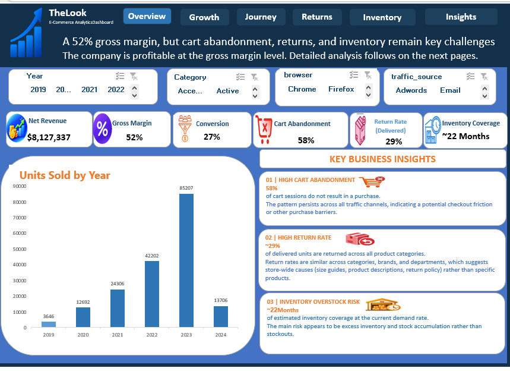
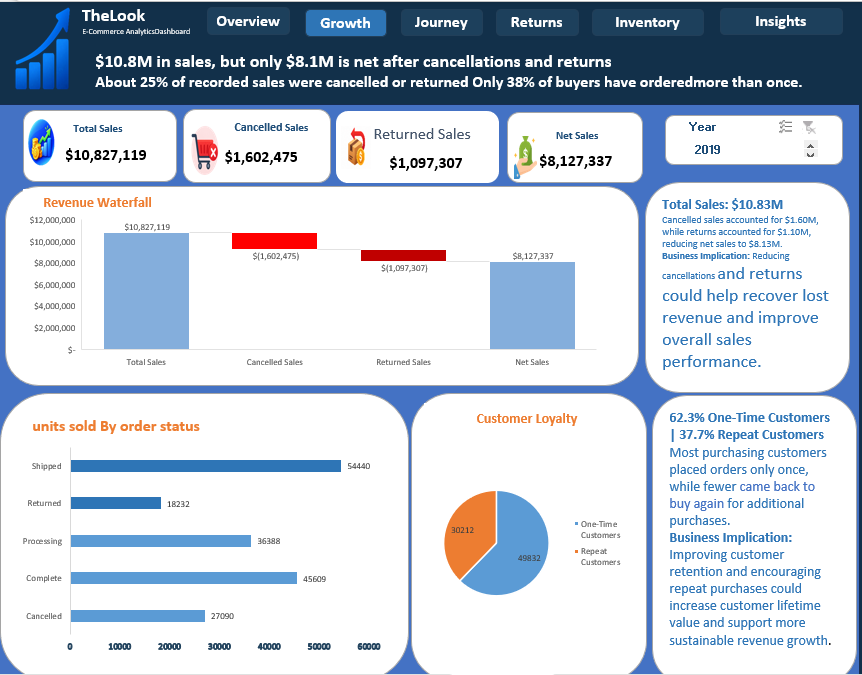
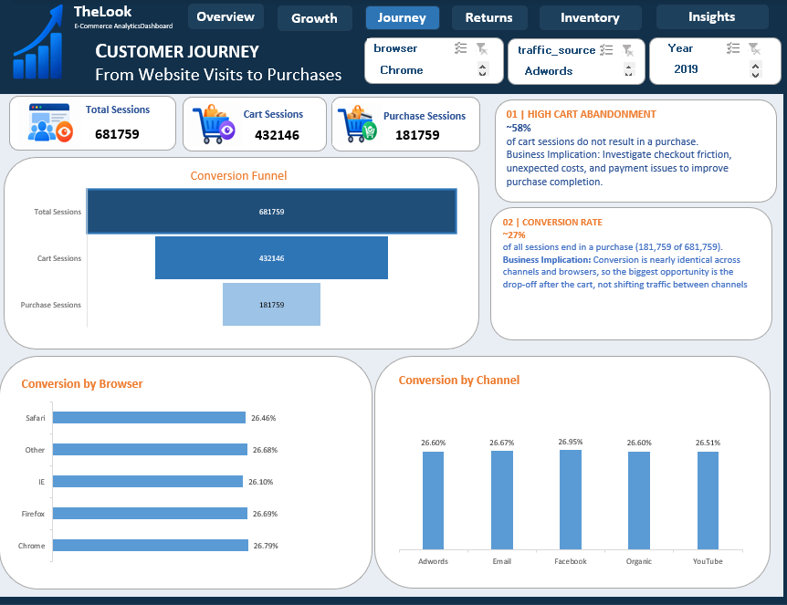
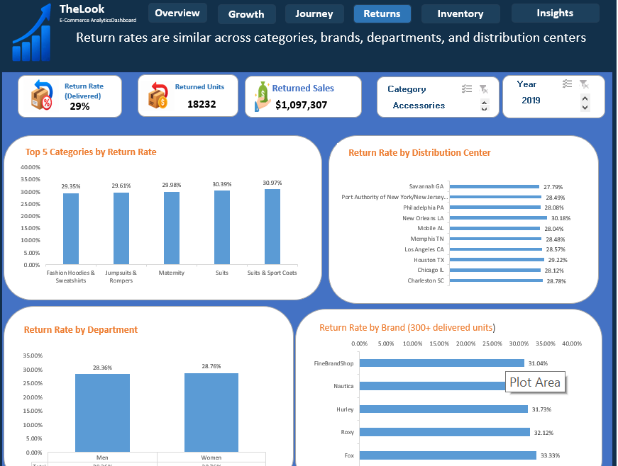
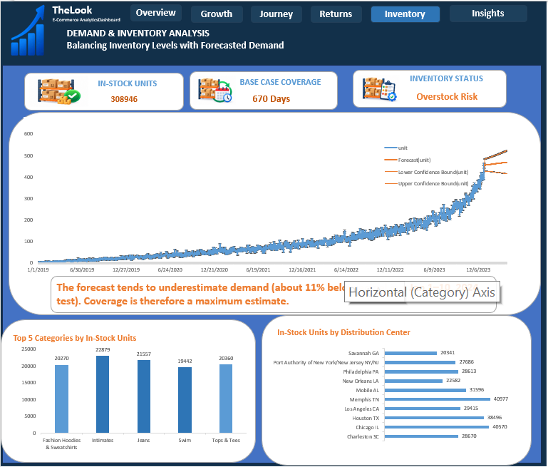
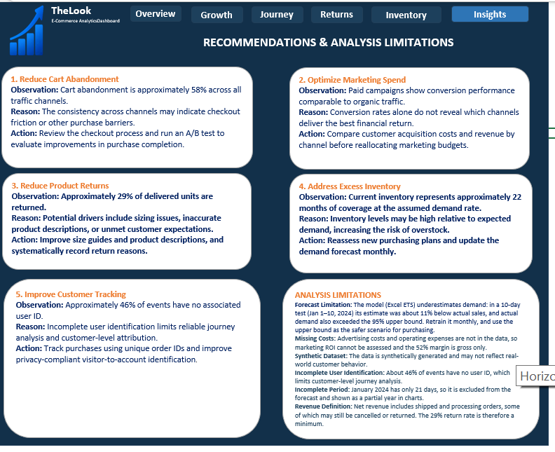

# TheLook eCommerce Analytics (Excel)

End-to-end analysis of an e-commerce dataset using **Excel only**: Power Query, Power Pivot (Data Model), DAX, and Forecast Sheet. Built as a training project.

## Business question

TheLook struggles with high cart abandonment and rising product returns. The goal: find **where** and **why** this happens in the customer journey, and give 3 to 5 actionable recommendations.

## Key findings

| Finding | Number |
|---|---|
| Gross margin after removing cancelled and returned items | 51.89% |
| Net revenue (of $10.83M recorded sales) | $8.13M |
| Cart abandonment (cart sessions with no purchase) | 57.94% |
| Conversion across 5 traffic channels | 26.51% to 26.95% |
| Delivered units that are returned | 28.56% |
| Inventory coverage at forecast demand | about 22 months |

- Cart abandonment and returns are **uniform** across channels, browsers, weekdays, categories, brands, departments, and price bands. The causes look store-wide, not tied to one segment.
- Paid channels convert like organic traffic. The dataset has no ad costs, so ROI cannot be calculated.
- Inventory is excess stock, not a shortage risk. The forecast also underestimates demand (about 11% below actual in a 10-day test).

## Dashboard

## Tools and approach

- **Power Query:** cleaned 7 CSV tables, dropped heavy or duplicated columns, loaded as Connection Only into the Data Model.
- **Power Pivot:** star schema with two fact tables (order_items, events) and a Calendar table.
- **DAX:** sessions, funnel rates, net revenue, return rate on delivered units, inventory measures.
- **Forecast Sheet:** ETS model on 1,826 days (2019 to 2023), tested on 10 days of January 2024.

## Corrections made along the way

- Return rate first came out at 10%. After removing cancelled items it was 11.79%. Using delivered units as the base, it is **28.56%**, since items not yet delivered cannot be returned.
- A first look at the first 1,000 rows suggested `user_id` was empty. Profiling the full table showed 46% empty (anonymous visitors).
- Total sales included cancelled and returned items (25% of the total), so net revenue is used instead.

## Limitations

- No advertising cost or operating expenses, so margin is gross only.
- Synthetic dataset. Real customer behavior may differ.
- About 46% of events have no user ID.
- January 2024 is incomplete (21 days) and excluded from the forecast.
- Net revenue includes shipped and processing orders, so the 29% return rate is a minimum.

## Data source

TheLook eCommerce dataset (Looker, public on BigQuery). The raw CSV files are not included in this repository.
